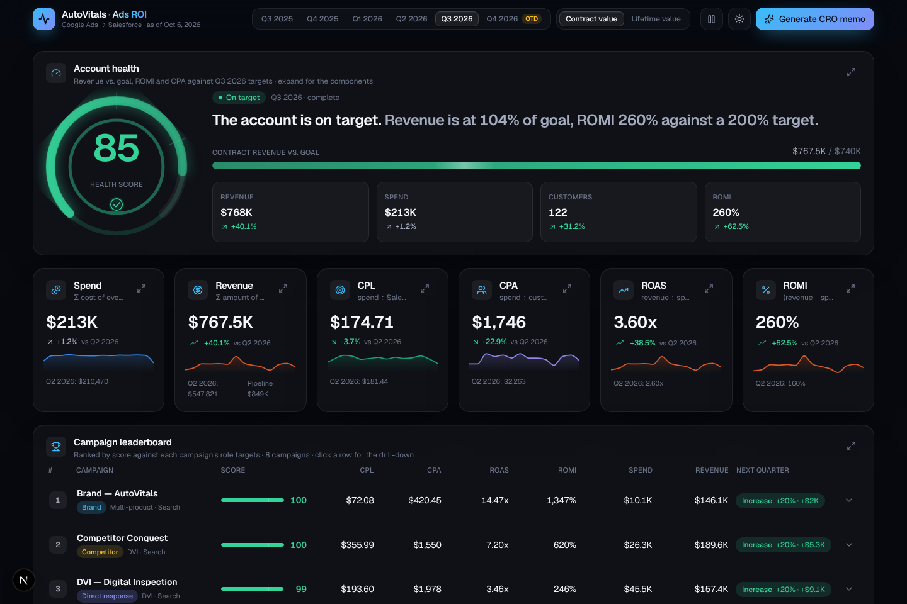
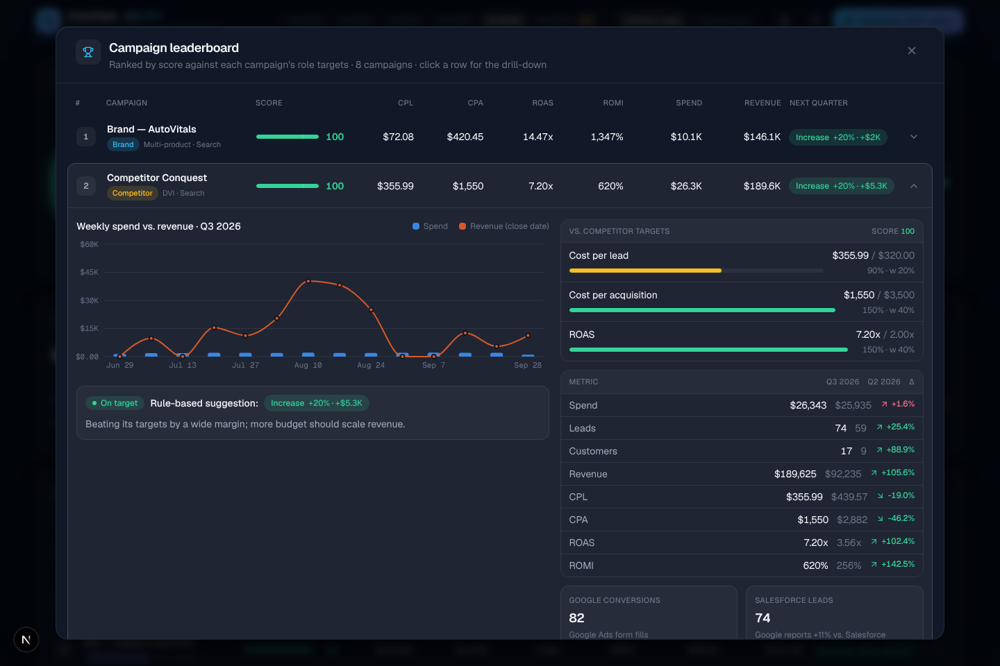
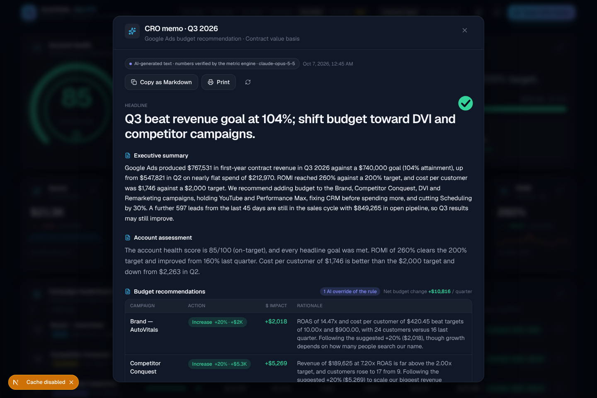
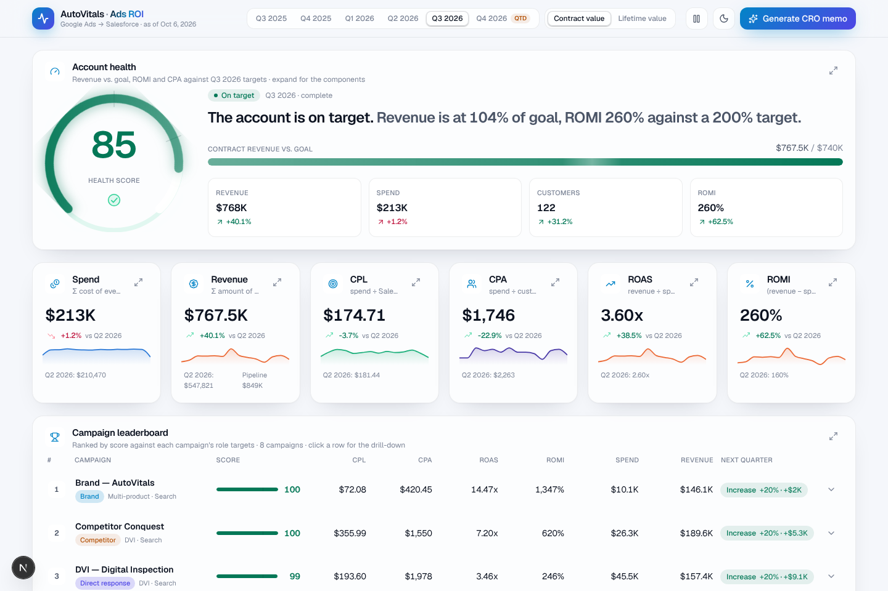
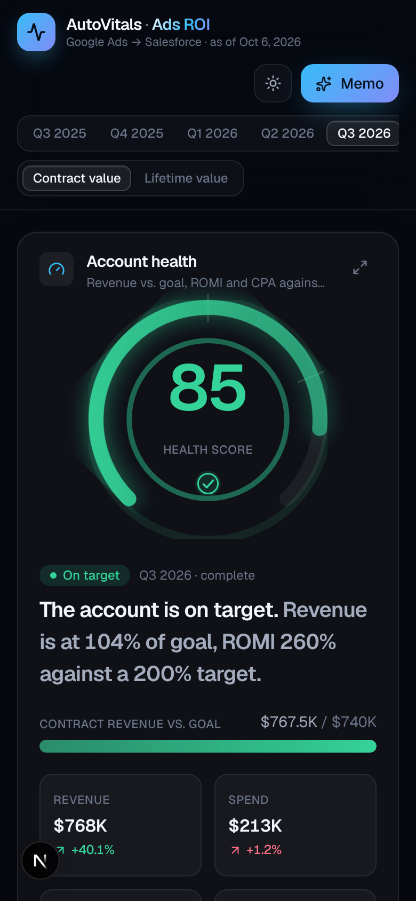
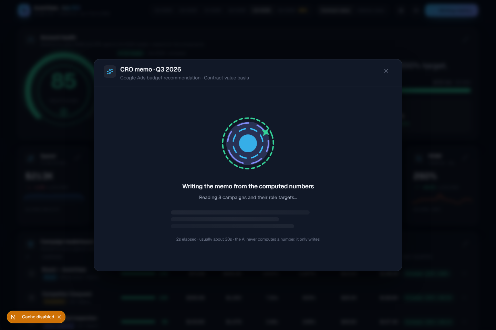

# AutoVitals Ads ROI

A Monday-morning dashboard and an AI-written quarterly memo that tie AutoVitals' Google Ads spend to Salesforce revenue. It replaces the manual workflow of exporting Google Ads data to Excel, merging it with Salesforce lead and revenue reports by hand, and presenting CPL, CPA, ROAS and ROMI to the CRO each quarter.

Hackathon proof of concept. The data is a deterministic mock of ~8 campaigns (one per product line); the data layer is built so the generator can be swapped for CSV uploads or the Google Ads and Salesforce APIs without touching the metric engine or the UI.



## What it shows

- **Account health score** (0–100) built from revenue vs. the CRO's quarterly goal (pro-rated for a quarter in progress), ROMI vs. target and CPA vs. target, with an animated gauge and the full component breakdown.
- **KPI strip**: spend, revenue, CPL, CPA, ROAS, ROMI, each with the quarter-over-quarter delta (colored by the right polarity: lower CPL/CPA is good), a weekly sparkline and an expandable definition.
- **Campaign leaderboard** ranked by a score against each campaign's *role* targets (brand, direct response, competitor, retargeting, awareness), with a rule-based budget suggestion per campaign and a drill-down: weekly spend vs. revenue, metric vs. target, this vs. previous quarter, Google conversions vs. Salesforce leads.
- **Product-line comparison** with a per-campaign breakdown.
- **Trends**: weekly spend vs. revenue and leads vs. customers, with the 45-day maturing window (leads still inside the 30–45 day sales cycle) shaded on the chart.
- **Data trust panel**: eight integrity checks (spend ties out to the export to the cent, every campaign is mapped, lead attribution coverage, UTM clean-up, Google vs. Salesforce conversion variance, $0 closed-won deals, orphan opportunities, duplicates) plus the unattributed-leads callout.
- **CRO memo**: Claude writes the quarterly budget recommendation from the computed facts. Headline, executive summary, recommendations with dollar impact and net budget change, "AI departed from rule" badges, product-line insights, risks, data caveats and next-quarter focus. Copy as Markdown or print it as a clean document.

Controls: quarter selector (the in-progress quarter is labeled QTD), revenue basis toggle (first-year contract value or lifetime value), dark/light theme, and a pause button for animations.

| Campaign drill-down | CRO memo |
| --- | --- |
|  |  |

| Light theme | Mobile | Memo generating |
| --- | --- | --- |
|  |  |  |

## Running it

```bash
npm install
cp .env.local.example .env.local   # or create .env.local with ANTHROPIC_API_KEY=...
npm run dev
```

Open http://localhost:3000. Without an `ANTHROPIC_API_KEY`, the memo falls back to the rule-based recommendations and says so; the dashboard itself needs no key.

```bash
npm test            # metric engine tests (vitest)
npx tsc --noEmit    # types
npx eslint src      # lint
npm run build       # production build
```

Deploy on Vercel: import the repo, set `ANTHROPIC_API_KEY`, deploy. The key is only read server-side in `/api/memo`.

## How the numbers stay right

Data accuracy is the non-negotiable requirement, so the design draws a hard line between numbers and words:

- **Every metric is computed deterministically in code** (`src/lib/metrics.ts`) from the source rows, in integer cents, and unit-tested. Divide-by-zero gives `null` and renders as "—", never 0.
- **The UI never computes a business metric.** Components render `DashboardModel` (`src/lib/types.ts`) and only format values (`src/lib/format.ts`); the only arithmetic in components is display math such as a bar's width.
- **The AI never computes a number.** `/api/memo` recomputes the model on the server, hands Claude a facts sheet, and gets back schema-validated JSON. Dollar impacts are recalculated in code from the computed spend, every recommendation is compared with the rule-based suggestion so overrides are visible, and the text is labeled as AI-generated with the model name and timestamp.
- **Reconciliation checks are on screen.** The data trust panel proves that spend matches the Google Ads export, every campaign is mapped, and unattributed or questionable records are counted rather than hidden.
- **Attribution matches the manual process**: a lead belongs to a campaign through `utm_campaign` (trimmed, lower-cased, dashes normalized). Leads marked Google Ads with no usable UTM are reported separately.
- Revenue is booked on the opportunity close date; open deals are pipeline. Both contract value and lifetime value are available. Goals are on the contract basis, so the health score does not move with the toggle.

## Layout of the code

```
src/lib/data/config.ts      campaigns, product lines, role targets, quarterly goals (mock; edit here)
src/lib/data/generate.ts    seeded mock data: Google Ads daily rows + Salesforce leads/opportunities
src/lib/metrics.ts          deterministic metric engine
src/lib/reconcile.ts        data-integrity checks
src/lib/ai/memo.ts          facts sheet → Claude → finalized memo (dollar amounts computed in code)
src/app/api/memo/route.ts   POST { quarter, basis } → Memo
src/components/dashboard/   page sections (hero, KPIs, leaderboard, product lines, trends, trust, memo)
src/components/ui/          expandable card + overlay, animated numbers, badges, controls
src/components/charts/      Recharts wrappers and the SVG gauge
src/components/lottie/      hand-authored Lottie JSON animations and the player wrapper
src/app/globals.css         design tokens (brand palette, dark/light themes), print styles
```

Brand colors live in one place (`:root` in `globals.css`), so the palette can be swapped for AutoVitals' own without touching components.

Built with Next.js (App Router), React, Tailwind v4, Framer Motion, Lottie, Recharts and NumberFlow.
